# NeuroScope-3D — Frontend Spatial UI

A clinical-grade, spatial user interface for 3D multi-parametric brain MRI tumour segmentation and volumetric analysis. Built strictly for research and teaching purposes using public, de-identified datasets.

---

## Architecture & Data Flow

```mermaid
flowchart TD
    subgraph UI ["User Interface Components"]
        Upload["Upload Wizard (4 sequences + optional mask)"]
        Progress["Progress View (staged status & elapsed timer)"]
        Scene3D["Three.js 3D Scene (world mm meshes & slice quads)"]
        Slices2D["NiiVue 2D Orthogonal Views (Axial, Coronal, Sagittal)"]
        Readout["Readout Panel (World mm & derived Voxel indices)"]
        VolumePanel["Volume Panel (analytical formula & estimated volume)"]
        Report["In-App Report & PDF Download"]
    end

    subgraph Store ["Zustand Store (Single Source of Truth)"]
        Crosshair["crosshairWorldMm [x, y, z] (RAS, mm)"]
        Affine["volumeAffine (4x4 matrix from NIfTI header)"]
        VoxelCoords["Derived Voxel Indices [i, j, k] = Affine^-1 * World"]
        Layers["regionVisibility & regionOpacity (WT, TC, ET, Brain)"]
        JobStatus["jobStatus ('idle' | 'uploading' | 'running' | 'done' | 'error')"]
    end

    subgraph API ["FastAPI Backend (Local Proxy /api)"]
        UploadAPI["POST /api/upload/"]
        PredictAPI["POST /api/predict/{case_id}"]
        PollAPI["GET /api/results/{case_id}"]
        MeshesAPI["GET /api/results/{case_id}/meshes"]
        SegAPI["GET /api/results/{case_id}/segmentation"]
        ReportAPI["GET /api/results/{case_id}/report"]
    end

    Upload -->|Upload NIfTIs| UploadAPI
    UploadAPI -->|case_id| PredictAPI
    Progress -->|Poll status| PollAPI
    PollAPI -->|Done + Volumes| Store
    MeshesAPI -->|3D Geometries in world mm| Scene3D
    SegAPI -->|NIfTI mask stream| Slices2D

    Crosshair <-->|Two-way sync| Scene3D
    Crosshair <-->|Two-way sync| Slices2D
    Crosshair <-->|Two-way sync| Readout
    Affine --> VoxelCoords
    Crosshair --> VoxelCoords
    Store --> VolumePanel
```



---

## Coordinate Math: World Space vs. Voxel Indices

Coordinates in NeuroScope-3D live strictly in **World Space (RAS, mm)** as the single source of truth:
- Voxel coordinates are derived dynamically via the inverse affine transform:
  $$\begin{bmatrix} i \\ j \\ k \\ 1 \end{bmatrix} = A^{-1} \begin{bmatrix} x \\ y \\ z \\ 1 \end{bmatrix}$$
- Negative-determinant affines ($\det(A) < 0$, standard radiological / sagittal-flipped coordinate systems) are fully supported with winding-order correction and exact adjugate inversion.
- Analytical volumetric formulas:
  $$\text{Volume (mL)} = N_{\text{voxels}} \times |\det(A[:3, :3])| / 1000$$

---

## Key Hard Rules

1. **Non-bypassable Disclaimer:** Built into `RootLayout.tsx` across every route and view:
   > *"Research and teaching prototype only. Not a diagnosis. Uses public, de-identified research data only."*
2. **Regulatory Wording Compliance:** Banned-phrase linter (`scripts/lint-wording.mjs`) guards against misleading medical claims.
3. **Fail-Safe Operation:** If upload, validation, or inference fails, displays specific backend details without exposing raw stack traces, and strictly forbids rendering partial slices, meshes, or volume results.
4. **Local Execution:** No CDNs, no Google Fonts, no external trackers. Self-hosted Inter font via `@fontsource/inter`.

---

## Development & Testing Commands

```bash
# Run local development server (port 3000, proxies to backend on port 8000)
npm run dev

# Run Vitest unit tests (coordinate conversions, matrix inversion, volume formulas, sequence matcher)
npm test

# Run wording linter, ESLint, and Prettier formatting checks
npm run lint

# Format codebase
npm run format

# Build production bundle
npm run build
```
